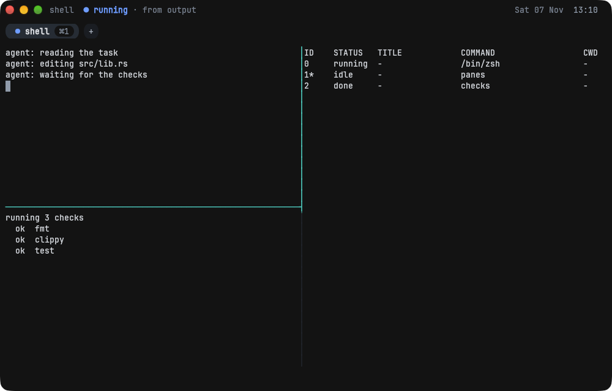

# PinFold


A memory-first terminal for agentic coding, written in Rust, with a built-in multiplexer.



## Install the beta

1. Download `PinFold.dmg` from the
   [v0.1.0-beta.3 release](https://github.com/0xPiranhaCodes/pinfold.sh/releases/tag/v0.1.0-beta.3).
2. Optionally, check it. Download `SHA256SUMS` from the same release into the same folder, then:

   ```sh
   shasum -a 256 -c SHA256SUMS --ignore-missing
   ```

3. Open the `.dmg` and drag PinFold to Applications. The app is signed and notarized, so macOS
   asks once whether to open an app from the Internet.
4. Optionally, link the `pinfold` command into a directory on your `PATH`:

   ```sh
   sudo mkdir -p /usr/local/bin
   sudo ln -sf /Applications/PinFold.app/Contents/MacOS/pinfold /usr/local/bin/pinfold
   ```

   The command finds the rest of PinFold beside the file the link points to, so link it, do
   not copy it.

**Requirements:** macOS 10.13.4 or later on Intel, or macOS 11 or later on Apple Silicon; the app
is universal. The automated tests run only on macOS 26.6 and the app has been run by hand only on
macOS 27, so older versions are untested
([#190](https://github.com/0xPiranhaCodes/pinfold.sh/issues/190)).

Linux packages come with the main release
([#47](https://github.com/0xPiranhaCodes/pinfold.sh/issues/47)).

## Quick start

1. Open PinFold from Applications, or run `pinfold`.
2. Press `⌘D` to split right, or the prefix `Ctrl+a` then `|`.
3. Press `⇧⌘D` to split down, or `Ctrl+a` then `-`.
4. Press `Ctrl+a` then an arrow to move focus, and run something in the pane.
5. Run `pinfold ctl list` to see each pane and its state.

[docs/configuration.md](docs/configuration.md#keys) lists every key.

## Why PinFold

- **Agent states you can read at a glance.** Each pane's state is a glyph, a colour and a word:
  ◆ needs you, ● running, ✓ done, ✕ error, ○ idle.
- **Prompts that output cannot fake.** PinFold draws its approvals outside pane text, so a
  program cannot print one.
- **A local, permissioned API.** Agents drive panes through a CLI and an MCP server over a local
  socket. Reading or typing into another pane asks you first, reads from another pane are
  redacted, and the core keeps an audit log of requests. See the
  [API reference](docs/api/README.md).
- **Sandboxed agent profiles.** A sandboxed agent cannot write outside its working and temporary
  directories, open another pane's terminal, read `~/.ssh` or the common credential stores such
  as `~/.aws`, `~/.config/gh` and browser profiles, get secret-looking environment variables its
  profile does not keep, or use the clipboard directly. It can read your other files and reach the
  network ([ADR-0041](docs/adr/0041-sandbox-hides-writes-not-secrets.md)).
- **Memory first.** Every subsystem has a budget that `cargo xtask mem-gate` checks. In an
  eight-hour Linux soak the core's PSS stayed between 4.31 and 4.64 MB
  ([benches/soak.md](benches/soak.md)).
- **Crash isolation.** A small core process owns your PTYs, so a crash in the window does not
  kill a running agent.

## Beta limits

- macOS only, and there is no update check: to update, download the new `.dmg`.
- Restoring a session brings back the layout and directories, but not the scrollback or what
  ran in a shell pane.
- A sandboxed agent can read credential stores not on the sandbox's list and reach the
  network. On macOS it can read the environment of your other processes, such as a token
  exported in another pane's shell
  ([ADR-0047](docs/adr/0047-macos-sandbox-reads-other-processes-environment.md)).

Read the [known issues](docs/beta/known-issues.md) before you report a bug.

## Use it

The prefix is `Ctrl+a`: press it, then `c` for a tab, `|` to split right or `-` to split down;
on macOS `⌘T`, `⌘D` and `⇧⌘D` do the same.

| Command                                     | What it does                                                  |
| ------------------------------------------- | ------------------------------------------------------------- |
| `pinfold`                                   | Open a window, starting PinFold if it is not running          |
| `pinfold up [dir]`                          | Open a project's `.pinfold/layout.toml` as tabs and panes     |
| `pinfold agent <name>`                      | In a pane, open a split running an `[agents.<name>]` profile  |
| `pinfold open <path>`                       | In a pane, open a file in the markdown reader or a directory in the file manager |
| `pinfold ctl list`                          | List the session's panes                                      |
| `pinfold ctl send <pane> <text>`            | Type text into a pane                                         |
| `pinfold ctl wait <pane> --until <event> --timeout <seconds>` | Wait until a pane's command exits, it prints or it goes quiet |
| `pinfold ctl grants`                        | List or revoke lasting cross-pane grants                      |
| `pinfold ctl log`                           | Print or verify the audit log of API calls                    |
| `pinfold ctl session save`                  | Save the session now                                          |
| `pinfold mcp`                               | Serve PinFold's tools to a coding agent over MCP              |

`pinfold --help` lists them, `pinfold <command> --help` explains one with examples, and
`pinfold --version` prints the version.

**Where PinFold keeps things:**

| What                                     | Where                                      |
| ---------------------------------------- | ------------------------------------------ |
| Config                                   | `~/.config/pinfold/pinfold.toml`           |
| Saved session, workspace trust, audit log | `~/Library/Application Support/PinFold`   |
| Agents' shadow git directories           | `~/.local/share/pinfold`                   |
| Socket and the logs, `default.log` and `.1` | `$TMPDIR/pinfold-$(id -u)`              |

`XDG_CONFIG_HOME` and `XDG_DATA_HOME` move the first and third.

**Configure it:** every setting is a key in `pinfold.toml`, and a save applies within about a
second, with no restart. On macOS, PinFold > Settings (`⌘,`) opens the file.
[docs/configuration.md](docs/configuration.md) lists every key, its default and the paths above.

### Themes

Themes are on `main` and arrive in the next beta; `v0.1.0-beta.3` does not have them. Eleven
come with PinFold beside the default, Graphite Grid: GitHub Dark, GitHub Light, Dracula,
Solarized Dark, Solarized Light, One Dark, Nord, Gruvbox Dark, Tokyo Night, Catppuccin Mocha and
Catppuccin Latte. Name one in `pinfold.toml`, or one each for the system's light and dark
appearance:

```toml
theme = "Nord"
# or
theme = { light = "GitHub Light", dark = "GitHub Dark" }
```

A Ghostty theme file or an iTerm2 `.itermcolors` preset works as it is: copy it into
`~/.config/pinfold/themes/` and name it. `[colors]` sets single colours on top of a theme, and
the agent states stay legible on every theme.
[docs/configuration.md](docs/configuration.md#themes) has the keys, the import rules and each
bundled theme's source and licence.

## Uninstall

Close every pane, with `⌘W` or `exit`, so the session and its core end;
`pgrep -x pinfold-core` then prints nothing. Then:

```sh
sudo rm -f /usr/local/bin/pinfold
rm -rf /Applications/PinFold.app ~/.config/pinfold "$HOME/Library/Application Support/PinFold" \
  ~/.local/share/pinfold "$TMPDIR/pinfold-$(id -u)"
```

The second command also removes your config, the workspaces you trusted, and agents' commits
that you have not fetched. Leave out the paths you want to keep.

## Documentation

- Beta: [known issues](docs/beta/known-issues.md) and the
  [manual checks](docs/beta/manual-checks.md) the maintainer runs before each beta
- [Goals, non-goals and memory targets](docs/design/goals.md)
- [Architecture](docs/design/architecture.md) and its
  [review](docs/design/architecture-review.md). Where they disagree the review
  wins, and the [ADRs](docs/adr/) override both.
- [Roadmap](docs/roadmap.md)
- [Threat model](docs/design/threat-model.md)
- [UI design](docs/design/ui/)

## Contributing and security

- Read [CONTRIBUTING.md](CONTRIBUTING.md) to get started.
- Report vulnerabilities as described in [SECURITY.md](SECURITY.md), not in public issues.
- This project follows the [Code of Conduct](CODE_OF_CONDUCT.md). Decisions are made as
  described in [GOVERNANCE.md](GOVERNANCE.md).

## License

Licensed under either of [Apache License, Version 2.0](LICENSE-APACHE) or
[MIT license](LICENSE-MIT), at your option. Any fork of `alacritty_terminal` code
stays Apache-2.0 only ([ADR-0012](docs/adr/0012-license.md)).

The bundled JetBrains Mono font is under the
[SIL Open Font License 1.1](crates/pinfold-render/fonts/OFL.txt).

The name and logo are covered by [TRADEMARK.md](TRADEMARK.md).
